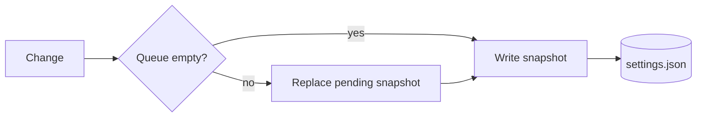

# Settings storage migration

A sample document for checking psy.md. All names and values are invented.

## Context

The application keeps its preferences in three places today. This plan moves them into
two files and makes every write atomic. See [the glossary](linked.md#terms) for the words
used here, or jump to [the risks](#risks).

Long identifiers must wrap: `SettingsStorageMigrationCoordinatorFactoryProviderSingleton` and
https://example.com/a/very/long/path/that/keeps/going/without/any/natural/break/point/at/all.html

## Goals and limits

- **One source of truth** for every setting
- *Atomic* writes, never a half-written file
- ~~A database~~ plain JSON files
  - nested item with `inline code`
  - another nested item
    1. ordered inside unordered
    2. second step

### Non-goals

1. Syncing settings between machines
2. Encrypting settings at rest

## Design

### Read path

> Reads never block the interface. A missing file means defaults; a broken file is kept
> aside as `settings.json.bad`.

| Setting | Old location | New location | Size |
|:--------|:-------------|:-------------|-----:|
| Theme | `prefs.ini` | `settings.json` → `appearance.theme` | 12 B |
| Window size | registry | `session.json` → `window` | 48 B |
| Recent files | `recent.txt` | `session.json` → `recent` | 1.2 KB |
| A cell with a much longer description that should wrap or scroll sideways in a narrow window | x | y | 0 B |

### Write path

Every change produces a full snapshot, numbered so that a reader can tell which one is current. The writer serialises it, writes a temporary file
next to the target and renames it into place.

```rust
fn write_atomic(path: &Path, bytes: &[u8]) -> io::Result<()> {
    let tmp = path.with_extension("tmp"); // same directory, same volume
    fs::write(&tmp, bytes)?;
    fs::rename(&tmp, path)
}
```

```ts
export function debounce<T extends unknown[]>(fn: (...args: T) => void, ms = 150) {
  let timer: ReturnType<typeof setTimeout> | undefined;
  return (...args: T) => {
    clearTimeout(timer);
    timer = setTimeout(() => fn(...args), ms);
  };
}
```



### Migration

- [x] Read `prefs.ini` once on first start
- [x] Keep the old file as `prefs.ini.bak`
- [ ] Remove the registry keys after two releases


## Risks

A footnote about file locking on Windows[^lock] and one about networks[^net].

<details>
<summary>Raw HTML that stays inert</summary>

<kbd>Ctrl</kbd> + <kbd>S</kbd> saves. H<sub>2</sub>O and x<sup>2</sup> render.
<script>alert("this must never run")</script>


</details>

External image (blocked until allowed):


---

[^lock]: Virus scanners may hold the file for a moment; the save is retried.
[^net]: Network drives can report changes late.
